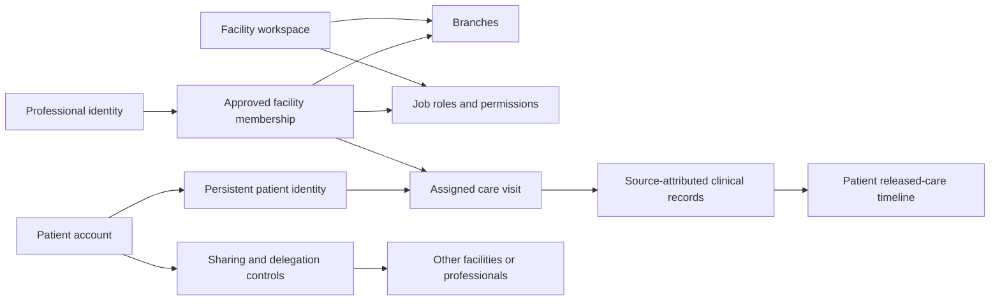

# HealthPass product definition and build approach

Prepared 11 October 2026 from the owner's specification, subsequent decisions, current HealthPass code and inspected RxLedger reference. This is a working product plan, not a claim that the target features already exist.

Evidence labels: **CONFIRMED** means an owner decision; **IMPLEMENTED** means present in the inspected code; **RECOMMENDED** means the proposed design/build approach; **OPEN** means a decision still needed. Later owner decisions supersede the original specification. Keep [the original blueprint](healthpass-blueprint-v1.txt) unchanged.

## Product purpose

**CONFIRMED:** HealthPass is an EMR/EHR workspace for care facilities and a personal care-record experience for patients. It connects care across participating facilities while preserving each contributor's identity, source and history. A professional records and delivers care in the right facility context; a patient can understand their care and manage who receives their information.

The unit of work is a **care visit**, linked to a persistent patient identity and a particular facility, branch and accountable professional. The long-term timeline joins authorised care events across facilities. It is not unrestricted access to every facility's records.

**RECOMMENDED first operating context:** outpatient/primary-care facilities, including nursing and medication-review workflows. Use GreenSprings as a candidate workflow walkthrough, not an assumed approved real-patient pilot. Full inpatient, theatre and hospital ERP workflows follow demonstrated demand.

## People and their relationship to the app

| Participant                                | Why they use HealthPass                                                            | Account/context                                                         | Boundary                                                                                                |
| ------------------------------------------ | ---------------------------------------------------------------------------------- | ----------------------------------------------------------------------- | ------------------------------------------------------------------------------------------------------- |
| Patient                                    | Understand care, retrieve released records, manage sharing and follow-up           | Patient account, independent of facility employment                     | Own records and explicit delegation; cannot overwrite another person's signed findings                  |
| Facility creator/administrator             | Set up the facility, branches, staff, services and access                          | Professional identity with administrative permissions in that workspace | Facility is an organisation, not a person signing in; administration alone grants no clinical authority |
| General practitioner/authorised consultant | Review permitted history, consult, document care and later issue authorised orders | Approved professional account, workspace and branch                     | Reviewed clinical scope, care relationship and patient permissions                                      |
| Nurse/midwife                              | Triage, observations, nursing care and follow-up                                   | Approved nursing professional in the facility                           | Own reviewed discipline; no implied prescriber authority                                                |
| Pharmacist                                 | Medication review and prescription clarification                                   | Reviewed professional clinical scope                                    | HealthPass holds relevant clinical review; RxLedger owns pharmacy dispensing and stock operations       |
| Pharmacy technician                        | Assist with permitted registry and later applicable operational tasks              | Professional account with assigned roles                                | Job title does not imply full chart, signing, prescribing or pharmacist privileges                      |
| Receptionist                               | Register/link patients, arrange arrival, appointments and routing                  | Professional account with limited operational access                    | Necessary demographic/contact data, not routine clinical notes                                          |
| Accountant/cashier/business staff          | Perform applicable billing/reporting or administrative tasks                       | Custom facility roles                                                   | Access only to implemented, granted tools and necessary data; titles alone grant nothing                |
| Proxy/guardian                             | Help a patient under an explicit delegation                                        | RECOMMENDED separate identified delegate linked to patient              | Scoped authority, expiry, revocation and verified release; no shared-password model                     |
| External healthcare professional           | Contribute an authorised consultation, therapy note or prescription                | RECOMMENDED verified contributor identity and invitation                | Patient-authorised contribution, reviewed credentials, clear source and no unrestricted browsing        |
| Laboratory/referral partner                | Receive an assigned request and return a verified outcome                          | RECOMMENDED scoped partner connection or contributor account            | Minimum required identifiers and assigned orders                                                        |
| HMO/claims partner                         | Handle coverage/authorisation and relevant claim evidence                          | RECOMMENDED contracted partner workflow                                 | HMO remains authority for its decisions; no blanket clinical chart access                               |
| Zed Tech Health Services support           | Help facilities operate the service onsite or remotely                             | Operator-verified support identity, approved temporary facility grant   | Current support sees workspace information, not patient records or team identities                      |
| Zed Tech platform operator                 | Operate hosting, integrations, service health and workspace metadata               | RECOMMENDED separately provisioned platform authority                   | Platform authority must never be inferred from a facility-admin role; no automatic clinical access      |

**CONFIRMED account paths:** Create account has Patient, Professional and Facility. Sign in has Patient and Professional. Professional creation requires the facility workspace code and uses Request access. Professional sign-in checks the workspace code and displays the facility before proceeding. The creator can immediately administer the facility; other staff require approval.

**CONFIRMED identity flexibility:** a person working at hospitals A and B may use the same email/password or different credentials. Their facility identities remain independently scoped. Do not infer cross-facility access from matching email. A person may also hold a separate patient account.

## Care, records and access relationships

The diagram is the **RECOMMENDED target relationship model**. Patient-issued facility registration and explicit clinical handoffs are implemented. Named-professional whole-category sharing and one-level delegation are implemented. New facility profiles support invitation claiming, existing-account registration requests and primary-facility decisions; reviewed claiming of historical unrelated charts, proxies and line-level protection remain planned.

**RECOMMENDED authorisation rule:** allow an action only when the account/session is valid, the facility membership and branch context permit it, the action is granted, applicable professional credentials cover the discipline, and the patient/record relationship permits the requested information. Apply these checks on the server before returning data. A hidden button is not an access boundary.

Patient-directed requirements already requested by the owner, with policy details still **OPEN**:

- A patient chooses a primary care facility and defines the information it may access. Primary designation does not automatically unlock every sensitive record.
- A patient can select named professionals for partial or full access. A consultation initially belongs to its assigned consultant's permitted care context; sharing with a colleague or outside professional needs an explicit scoped delegation.
- A patient can appoint proxies. A code sent by phone/email participates in a verified release process; it is not blanket authority over the record.
- In an emergency, caregivers can request necessary privileged information through the primary facility or authorised proxy. Define requester verification, release authority, scope, expiry and audit before enabling this pathway.
- Rai may later help identify sensitive content and prepare redacted views. Code-enforced access to the original text remains authoritative. Protected content must also stay protected in search, summaries, exports, attachments and model inputs. No model may grant access.

**RECOMMENDED record governance:** patients control supported sharing choices; source facilities/professionals remain accountable for their authored records. A patient can request a correction, and another professional can contribute a new record, but neither silently replaces a signed source record. Exact retention and disclosure obligations require a reviewed policy. Revoking future access does not erase historical care.

## What belongs in HealthPass

| Module                                  | Daily job it supports                                       | Current position                                                                                                                    | Target addition                                                                                                     |
| --------------------------------------- | ----------------------------------------------------------- | ----------------------------------------------------------------------------------------------------------------------------------- | ------------------------------------------------------------------------------------------------------------------- |
| Identity, workspaces and access         | Work in the correct facility with appropriate authority     | IMPLEMENTED accounts, branches, custom roles, reviewed clinical scopes, optional authenticator, idle timeout                        | Recovery, verified linking, care assignments, individual/proxy grants                                               |
| Patient registry and chart              | Find the correct patient and relevant care history          | IMPLEMENTED registry, facility/branch links, allergy context, signed history                                                        | Verified existing-record linking, structured problems/medicines/observations, source-labelled longitudinal timeline |
| Visits and clinical documentation       | Receive a patient, triage, consult and complete the visit   | IMPLEMENTED branch queue, explicit handoff/acceptance, observations, linked draft/sign/amend notes and author-owned follow-up tasks | Delivered reminders and further coordinated care tasks                                                              |
| Patient experience                      | Understand released care and manage information sharing     | IMPLEMENTED own signed records, opt-in named/category sharing, one-level delegation and access history                              | Primary facility, proxies, individual-note protection, appointments and care instructions                           |
| Prescriptions and medication continuity | Create an authorised order and know what was supplied       | PLANNED                                                                                                                             | Structured signed prescriptions, clarification, cancellation/amendment, partial fulfilment and RxLedger feedback    |
| Appointments and remote care            | Book, arrive, consult and follow up                         | PLANNED                                                                                                                             | Provider availability, booking, reminders, waiting room, secure chat, voice/video and approved uploads              |
| Results and referrals                   | Request a test or referral and close the loop               | PLANNED                                                                                                                             | Assigned orders, verified results, review/release, corrections and outstanding-action queues                        |
| Facility operations and reporting       | Understand and manage the day's work                        | IMPLEMENTED branches, staff/roles and audit                                                                                         | Services, care workload, follow-up/outstanding-task reports and subsequently approved billing                       |
| Integrations and platform operations    | Connect services reliably and support facilities            | IMPLEMENTED private API and limited support grants                                                                                  | Scoped partner adapters, delivery/reconciliation queue, separate operator workspace                                 |
| Rai assistance                          | Retrieve/explain permitted context and assist reviewed work | PLANNED                                                                                                                             | Deterministic retrieval first; evaluated summaries/redaction/support later                                          |

Do not present planned modules as live buttons or grant invented permissions for them. Existing accounting/IT job titles are useful only when relevant tools/operational permissions are actually assigned.

## Ecosystem responsibilities

**CONFIRMED:** HealthPass owns care records, encounters, care plans, scheduling, telemedicine, signed prescription orders, referrals and record-access governance. RxLedger owns pharmacy inventory, batch/packaging/pricing logic, POS, dispensing transactions and pharmacy fulfilment/continuity. HealthPass receives relevant fulfilment events; it does not duplicate the pharmacy system. Rai owns AI orchestration and explanations through permitted APIs. The ecosystem authenticator remains a separately planned app.

**RECOMMENDED shared foundations:** familiar branding, navigation behaviour, account-context display, component conventions, permission vocabulary where applicable, and narrow versioned integration contracts. Shared appearance or later federation does not imply shared credentials, pooled databases or universal permission.

Each integration event needs an authoritative source, stable identifier, version, patient-linking basis, minimal payload, delivery status and duplicate handling. Missing medicine mappings or missing access must be visible rather than guessed.

## What to borrow from RxLedger

Inspected local reference: `Zubish/RxLedger` commit `5c9aea652147123921ae9a433fab0b573c5eda27`. This is a reference snapshot, not proof of its latest live deployment.

| Inspected pattern                                                              | Apply in HealthPass                                               | Adaptation                                                                                      |
| ------------------------------------------------------------------------------ | ----------------------------------------------------------------- | ----------------------------------------------------------------------------------------------- |
| Workspace resolution in `server/_shared.ts` and account forms                  | Confirm facility context before login/actions                     | Retain HealthPass's explicit workspace code and independent professional identities             |
| Branch scope enforced before payload serialisation in `server/branch-scope.ts` | Return only authorised records/tasks/metrics                      | Clinical access also needs reviewed scope, patient relationship and consent                     |
| Compact operational shell with visible branch context                          | Patient, care-team and admin task-focused experiences             | Different home screens by responsibilities, not a pharmacy dashboard copied into an EHR         |
| Lazy bounded history, summaries and mutation deltas                            | Load chart summaries first; paginate history; aggregate on server | Never send a full patient/facility database to the browser                                      |
| Continuity Centre follows a real unmet-need lifecycle                          | Track referral/results/follow-up requests to a real outcome       | Model explicit assigned/open/completed states, not decorative dashboard counts                  |
| URL navigation and workspace-scoped preferences                                | Back/forward/refresh preserve views; remembered prompts persist   | Keep clinical text and credentials out of URLs and shared browser storage                       |
| Portable skill library and evidence-based verification                         | Save stable decisions and verify real flows after deploy          | Tests use synthetic content; clinical drafts need stronger handling than short-lived POS drafts |

Do **not** copy RxLedger's tenant JSONB state layout into HealthPass. Clinical provenance, signed versions, consent and fine-grained access fit HealthPass's existing relational tables and immutable-record controls. RxLedger's performance improvements are lessons to apply, not a reason to repeat an earlier whole-state loading design.

## Architecture approach

**RECOMMENDED:** keep one modular application backend with clear domain boundaries, using the existing React 19/TanStack Start/TypeScript frontend, Node API and PostgreSQL on Neon. Vercel serves the web and private API proxy; Neon runs the current backend. SQLite remains local/test only. Retain the current deployment and original blueprint rather than starting another app or changing frameworks during definition work.

Grow backend modules for identity/workspaces, registry/linking, access/consent, visits/records, prescriptions, scheduling, results/referrals, messaging/attachments, integrations and audit. Extract cohesive modules from `server/api.mjs` as each slice is built; avoid a wholesale rewrite of working authentication and authorisation. Frontend module boundaries should follow work surfaces rather than one ever-growing workspace component.

Target data objects: facility, branch, identity, membership, job role, reviewed credential scope, patient identity, verified patient-account/facility link, visit, care-team assignment, observation, encounter and signed version, order, prescription version, result/referral, task, sharing grant, delegate authority, partner event and audit. Add objects only with their owning workflow; a row in a schema does not establish access policy.

When partner integration starts, add transactional outbox/inbox records with idempotency keys and controlled retries. Private attachments need authorised short-lived retrieval, content checks and provenance. Operational logs/telemetry use bounded identifiers and timing, not clinical content. Capacity changes and additional services should follow measured need.

## Build order and acceptance

These are **RECOMMENDED milestones**, not estimates or assertions of owner-approved policy. This plan refines the original stages by completing routine care and identity linkage before broad integrations.

| Milestone                            | Concrete deliverable                                                                                                                  | Exit evidence                                                                                                                                                                 |
| ------------------------------------ | ------------------------------------------------------------------------------------------------------------------------------------- | ----------------------------------------------------------------------------------------------------------------------------------------------------------------------------- |
| 0. Product/workflow contract         | Agree the first facility scenario; map each role's before/during/after work; inventory current gaps                                   | A named synthetic patient journey and action/data permission matrix; unresolved access policies remain explicit                                                               |
| 1. Trusted patient linking           | Link an existing patient account/HealthPass identity to a facility record through a verified process, with duplicate review and audit | Same patient can receive care in two participating facilities and view permitted signed records; matching email/name/phone alone never merges identities                      |
| 2. Complete outpatient visit         | Branch queue, check-in, assigned triage/consultation, structured observations, own signed note and follow-up task                     | Reception sees arrival/demographics; assigned nurse/consultant sees allowed care; patient sees released signed output; interrupted/stale writes do not lose or duplicate care |
| 3. Patient-directed access           | Named-professional grants, primary facility and then reviewed proxy/delegation flows                                                  | Requested scope enforced across APIs, search and history; expiry/revocation works; no hidden sensitive-content leakage                                                        |
| 4. Prescription loop                 | Structured authorised prescribing plus versioned RxLedger exchange and clarification                                                  | Synthetic prescription reaches the correct pharmacy, partial supply returns once, amendments retain history and failures are recoverable                                      |
| 5. Scheduling and remote care        | Booking, reminders and secure consultation-linked messaging; voice/video/uploads after vendor/policy decisions                        | No double-booking; only authorised participants join; disconnect/retry preserves work; released outputs reach the patient                                                     |
| 6. Results, referrals and operations | Assigned requests, result review/release and actionable overdue work; useful facility reporting                                       | Corrected results retain provenance; each outstanding request has an owner/outcome; dashboards count actual events                                                            |
| 7. Contracts, Rai and scale          | Contracted HMO/claims flows, separately scoped operator tools, evaluated Rai capabilities                                             | Real partner rules, bounded access, reliable operation during AI/integration outage and measured performance                                                                  |

**Implemented first operating slice:** patient-issued registration invitations, reception identity/duplicate review, a scoped branch queue, single-professional assignment, observations, signed consultation notes, follow-up tasks and visit completion. See [care workflow contract](care-workflows.md) for authority, retry guarantees and boundaries.

**Implemented clinical continuation:** explicit same-facility/branch handoff using patient-directed named access; outgoing responsibility stays until the recipient accepts, and authorship remains preserved. See [care handoffs](care-handoffs.md). **Next recommended slice:** patient-directed primary-facility and proxy authority, with emergency release designed separately. Claiming existing facility-created charts remains open: verification evidence and duplicate adjudication need a separate flow; this slice never merges or claims them.

## Screen and interaction plan

**RECOMMENDED care-team navigation:** Today's work, Patients, Visits, and later Appointments, Orders, Results/Referrals and Messages. Show Workspace/Staff/Roles/Audit only when granted. Keep facility, branch, patient, current visit and assigned professional clear at the point of action. Admin home should emphasise setup/access/operations, clinical home assigned work, reception home arrivals, and patient home care history/next steps.

**RECOMMENDED patient navigation:** My care, My records, Sharing & people, and later Appointments, Medicines, Results and Messages. Proxies select an authorised dependent explicitly. Patient home should explain the next action rather than reproduce a provider dashboard.

Use the supplied HealthPass wordmark and graphic favicon. Burgundy is an accent; white/slate foundations and restrained teal/blue surfaces support familiarity. Alerts retain semantic meaning. Mobile should support patient use and essential care-team actions; desktop supports dense clinical work. Every workflow defines loading, empty, denied, partial, unsaved, saving, saved, conflict, expired and failed states as applicable.

## Working discipline

For every slice: state the user/job, map the object and transitions, define authority and data retention, design phone/desktop states, implement UI/API/schema together, verify allowed and denied scenarios, then deploy and test the canonical domain. Preserve all existing identities and signed/audit history. No real patient data in fixtures or screenshots. Optional authenticator dismissal and the 30-minute idle timeout remain current owner decisions.

Before real-patient use, resolve the remaining identity/access, clinical review, recovery, data-location and restore requirements already recorded in the blueprint. The existing Neon development location is an owner-accepted current choice, not evidence of Nigerian hosting or launch certification.

## Source register

- [Original owner-supplied blueprint](healthpass-blueprint-v1.txt), especially sections 03–07, 12–14 and 19–20.
- [Current decisions and implementation](foundation.md), [accounts/workspaces](account-workspaces.md), [role rules](workspace-roles.md).
- HealthPass inspected sources: `server/api.mjs`, `server/roles.mjs`, `server/workspaces.mjs`, `server/db.mjs`, migrations 001–006, `src/components/healthpass/`, `src/lib/healthpass-types.ts`.
- RxLedger snapshot: `docs/SKILL_LIBRARY.md`, its workflow/UI/mobile/data/industry modules, `docs/APP_BLUEPRINT.md`, `docs/RXLEDGER_ECOSYSTEM_MODULES.md`, `docs/PLATFORM_ADMIN_PORTAL.md`, `src/components/AuthViews.tsx`, `server/_shared.ts`, `server/branch-scope.ts`, `src/navigation.ts` and `src/platform/contracts.ts`. Documentation claims were treated separately from source evidence and live verification.

The owner-approved registration and primary-care contract is recorded in [patient-onboarding.md](patient-onboarding.md). Email delivery requires a configured sender; the adapter and queue alone do not mean invitations have been delivered.

**CONFIRMED consultant accountability:** administrators assign the responsible consultant for a patient's ongoing management, including ward/inpatient care, while authorised GPs continue their own care work. This responsibility is distinct from the current visit assignee. The implemented foundation and its specialty-review/access boundaries are recorded in [care-responsibilities.md](care-responsibilities.md); full admission/bed/discharge operations remain separate.
